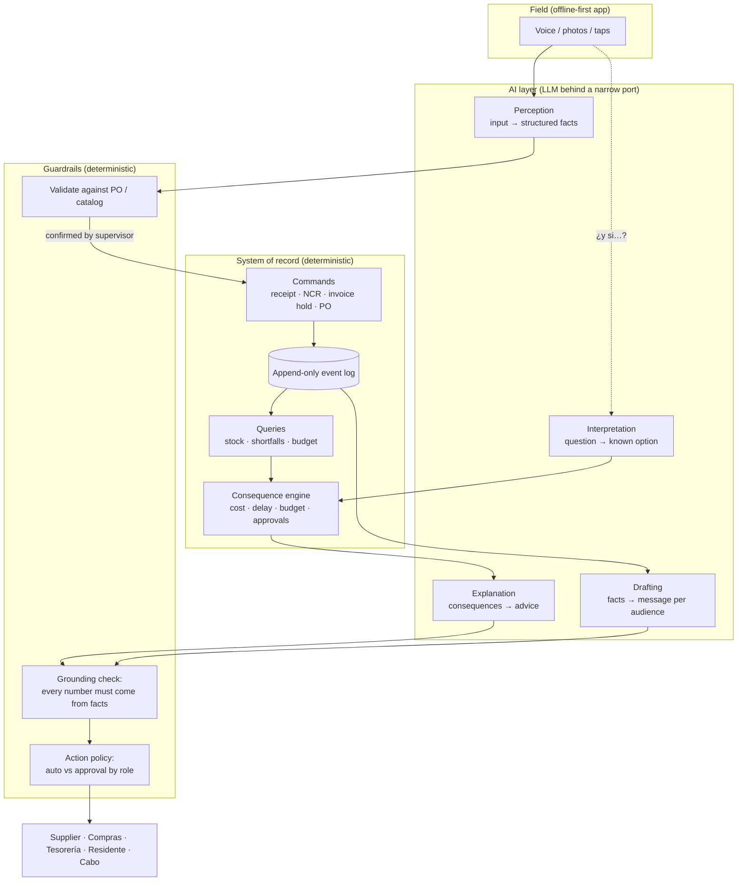
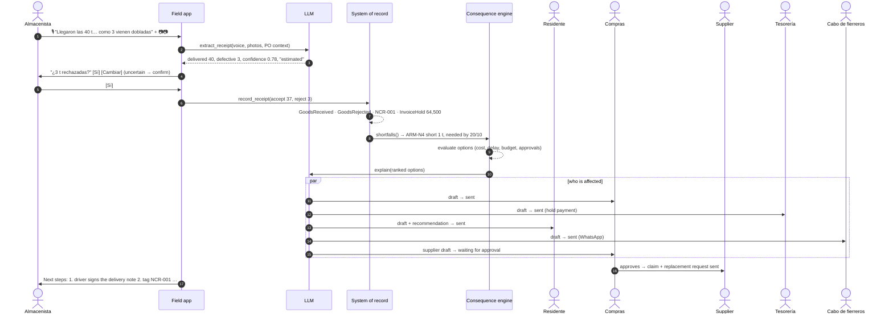

# How the Architecture Uses the LLM: Worked Examples

**The short version:** the AI coordinates people, and the system of record
moves money and materials. The LLM reads messy field input, works out who is
affected, writes to each of them in their own terms, and explains the options
for what to do next. Every number in those options comes from deterministic
code. Every action that commits money, goes to an outside party, or touches
the structure waits for the right person to approve it.

This follows directly from Vimani's non-negotiables:

| Constraint (from the company README) | What it means for the AI |
|---|---|
| *A wrong number costs money* | The LLM never computes or writes a quantity, price or date. It reads them and explains them. |
| *Confidence thresholds, human review where it matters, deterministic fallbacks* | Each AI output has a validator, an approval policy, and a template fallback. |
| *Field conditions are hostile* | One-tap confirmations, voice and photo input, and everything still works when the model is unreachable. |
| *Acceptance rate is a tracked metric* | Every suggestion is logged with what the human did with it. |

A runnable prototype of Example 1 is in [`prototype/`](prototype/). It uses
only the Python standard library and a fake LLM, so it's deterministic:

```bash
cd prototype
python demo.py              # full scenario, printed step by step
python -m unittest -v       # 17 guardrail tests
```

---

## 1. The layers



The LLM does **four jobs and only these four**:

| Job | Input → Output | What checks it |
|---|---|---|
| **Perception** | Voice note + photos → `{po, delivered, defective, defect, confidence}` | Matched against the purchase order. Asks for a one-tap confirmation if the reading is uncertain or estimated. |
| **Interpretation** | "¿Y si usamos las varillas dañadas?" → `use_rejected_material` | Must be one of the known option kinds. Anything else gets "I can't calculate that." |
| **Drafting** | Facts for one audience → a message in their language and tone | Every number in the text must appear in the facts, otherwise the template is sent instead. |
| **Explanation** | Computed, ranked options → advice for the residente | Same grounding check. |

What it **never** does: compute a quantity, price, date or budget figure, call
a command directly, choose who has to approve something, or send a message
outside the company without a person's approval.

---

## 2. Example 1: defective material arrives on site

> Monday, 19 Oct. The warehouse keeper (*almacenista*) at Torre Norte receives
> PO-1182: 40 t of 3/8" rebar from Aceros del Bajío. Some bundles are bent and
> rusted. They record a voice note and take two photos.

### Sequence



### Step by step (actual output of `python demo.py`)

**① Perception: AI.** The model reads the voice note and photos:
`delivered=40 t, defective=3 t (bent and rusted), confidence=0.78`.
Its confidence is under 0.90 and the count is an estimate ("como 3"), so the
app **asks the warehouse keeper to confirm**. The question is a single
gloves-friendly screen, not a form. If they correct it to 4, the log records
"edited", and that lowers the perception acceptance rate.

**② Commands: deterministic.** One confirmation produces four events in the
append-only log:

| Event | Effect |
|---|---|
| `GoodsReceived` 37 t | Site stock +37 t. PO line still has 3 t open (the supplier owes them). |
| `GoodsRejected` 3 t | Defect, photos and supplier attached. |
| `NonConformanceOpened` NCR-001 | The rejected material is now blocked from use. |
| `InvoiceHoldPlaced` 64,500 MXN | 3 t × 21,500. Billing can't pay that portion until the NCR is closed. |

**③ Impact: deterministic.** The schedule is read against stock:
*"Armado de acero losa N4" needs 38 t, there are 37 t, so 1 t is missing. It
must be on site by 20/10.* Nobody asked for this check. The rejection
triggered it.

**④ Options and consequences: deterministic numbers, AI wording.**

| # | Option | Cash out | Net cost | Delay | Budget after | Approval | Decide by |
|---|---|---|---|---|---|---|---|
| **1** | Buy 1 t from Ferretera Hidalgo (arrives today) | 25,370 | **3,870** | 0 d | 03.02.010 → 98.4% | residente | 20/10 |
| 2 | Split the slab work into two stages | 9,500 | 9,500 | 0 d | 01.05 → 94.7% | residente + **DRO** (structural engineer of record) | 20/10 |
| 3 | Wait for the supplier's replacement (arrives 22/10) | 78,000 | 78,000 | **2 d**, shifts ARM-N4 → COL-N4 → CIM-N5 | 01.05 → 98.0% | residente | — |

Why option 1 costs 3,870 net when it costs 25,370 up front: the supplier still
replaces the 3 t, so the ton bought locally becomes stock for the next level.
The real cost is only the price premium. That reasoning is code, not
model output. The AI's job is to say it clearly:

> *"Te recomiendo: Comprar 1 t a Ferretera Hidalgo. Cuesta 3870 MXN netos y
> retrasa el programa 0 días. Esperar al proveedor retrasa 2 días y cuesta
> 78000 MXN."*

**⑤ Coordination: AI drafts, policy decides.** Each party gets a message
written for them, containing only the facts they need:

| Who | Channel | Status | Message (AI-drafted, numbers checked) |
|---|---|---|---|
| Aceros del Bajío | email | ⏸ **waiting for compras** (external) | "…recibimos 37 t y rechazamos 3 t … (NCR-001, fotos adjuntas). Solicitamos reposición de 3 t…" |
| Compras (procurement) | app | ✅ sent | "NCR-001: … faltante de 1 t para 'Armado losa N4'. Mensaje al proveedor listo para tu aprobación." |
| Tesorería (treasury) | app | ✅ sent | "Retener 64500 MXN de la factura de la PO-1182/1 hasta cerrar la NCR-001." |
| Residente (site manager) | app | ✅ sent | "Faltan 1 t … Recomendado: Comprar 1 t a Ferretera Hidalgo. Decide antes del 20/10." |
| Cabo de fierreros (rebar foreman) | WhatsApp | ✅ sent | "Atención: 'Armado de acero losa N4' podría moverse. Te confirmamos hoy." |

The supplier's message **never** includes our budget, our margin, or the fact
that we're pricing another supplier. Least privilege is enforced by the facts
each audience receives, not by asking the model to be discreet.

**⑥ What the warehouse keeper should do next: ordered by what expires first.**

1. *Before the driver leaves:* note the rejection of 3 t on the delivery note
   and get the driver's signature. Without it, the claim against the supplier
   is much weaker.
2. Separate and tag the 3 t with NCR-001. Don't mix them with the accepted
   material.
3. Confirm the option for "Armado losa N4" with the residente before 20/10.

**⑦ "What happens if…?"** The warehouse keeper asks: *"¿Y si usamos las
varillas dañadas?"* (What if we use the damaged rebar?) The AI maps the
question to `use_rejected_material`. The consequence engine answers:

> **BLOCKED:** Material with an open non-conformance can't be used in
> structural elements without release by the DRO (the structural engineer of
> record), and using it voids the claim against the supplier.

A question the engine can't model (for example, *"what if we change the
structural design?"*) gets *"I can't calculate that option"*, never an
invented answer.

---

## 3. Who acts on what: the coordination matrix

Routing is a **table in code**, not a model decision. The model decides how
to *say* things, never *who* hears them or *whether* a message goes out.

| Event | Warehouse | Residente | Compras | Supplier | Tesorería | Foreman | DRO |
|---|---|---|---|---|---|---|---|
| Delivery rejected (full/partial) | next steps | impact + options | NCR, approve claim | claim ⏸ | payment hold | if task at risk | — |
| Shortfall vs schedule | — | options + deadline | quote alternatives | — | — | heads-up | — |
| Structural option chosen | — | — | — | — | — | — | approval ⏸ |
| Budget code > threshold | — | alert + drivers | — | — | — | — | — |
| Change order (*cambio de alcance*) | — | impact | re-quote | revised PO ⏸ | cash-flow update | new scope | if structural ⏸ |

⏸ = waits for a person's approval (`ACTION_POLICY` in `prototype/decisions.py`):

| Action | Policy |
|---|---|
| Internal notification, open NCR, payment hold | auto (internal and reversible) |
| Message to a supplier or client | approval by compras |
| Purchase ≤ 50,000 MXN | approval by residente |
| Purchase > 50,000 MXN | approval by gerente (manager) |
| Schedule change | approval by residente |
| Anything structural | approval by DRO |

---

## 4. Guardrails: how a wrong model stays harmless

Each of these failure modes has a test in `prototype/test_coordinator.py`:

| Failure | What the architecture does |
|---|---|
| Model misreads the quantity | Below 0.90 confidence or estimated → one-tap confirmation. Corrections are logged as "edited". |
| Model reads the wrong PO | Rejected outright. The app falls back to manual entry. |
| Model leaves out its confidence | Treated as **zero** confidence, not 1.0. |
| Model changes a number in a draft ("3 t" → "5 t") | Grounding check fails, so the template message is sent instead and the event is logged. |
| Model is unreachable (no signal) | Every message goes out as a template. Recommendations still work, because the numbers never came from the model. |
| Model suggests something unsafe | The consequence engine blocks it and says why. |
| Supervisor asks something the engine can't model | "I can't calculate that." Never a guess. |
| Text typed in the field tries to instruct the model (prompt injection) | The model has no tools that change state. The worst it can do is draft a message, which is checked and goes through approval. |

---

## 5. More examples (same pattern)

### Example 2: budget overrun before month-end close (*cierre de mes*)

| Step | Who | What |
|---|---|---|
| Invoice posted to 03.02.010 | System of record | Totals roll up (the interview exercise's Part 2). Exposure reaches 104%. |
| Alert | Deterministic | Exposure > budget × (1 + threshold) (the exercise's Part 3). |
| Why? | **AI** | Reads the postings behind it: "+12% unit price on rebar since the August PO; 2 t of extra waste on level 3." Every figure is linked to its source posting. |
| What next? | Consequence engine | Options: renegotiate the price for the rest of the steel, use the contingency line (01.09), or start a change order with the client. Each shows its effect on the final cost. |
| Who hears it | Routing table | Residente (decision), compras (renegotiation), director (if contingency is used). |

### Example 3: the 6 a.m. briefing for each role

Every morning, deterministic queries cross tomorrow's schedule with stock,
open POs, bookings and weather. The AI turns the result into a short
checklist for each role, in their language:

> **Cabo de colado:** Mañana colado losa N4. ✅ 120 m³ concreto confirmados.
> ⚠️ **Bomba sin confirmar.** Llama a Bombeos MX antes de las 10:00: si no
> confirma, el colado se mueve y cuesta 43,000 MXN por día.

Every item is a query result. The AI decides only the order and the wording.

### Example 4: change order requested by the client

The client asks to add a balcony on level 7. The AI pulls the scope out of the
email. The engine computes the new BOQ lines (*catálogo de conceptos*), cost
codes, budget delta, schedule impact and approvals: client signature, DRO for
structure, and compras for new POs. The AI writes one summary for the client
(price and dates only) and a different one internally (margin and risk).

---

## 6. Measuring it (so it improves without breaking what already worked)

- **Every AI output is a `Suggestion`** in the log, recording the model
  version, whether it passed validation, whether the fallback was used, and
  what the human did (`accepted` / `edited` / `rejected`). That gives the
  acceptance rate per job (perception, drafting, explanation) and per
  project.
- **The eval set is built from real field data.** Each confirmed or corrected
  field report becomes a labeled example. A model or prompt change ships only
  if it doesn't lower acceptance on that set. This is the *"how it's improved
  without degrading what already worked"* from the job posting.
- **Shadow mode first.** A new AI job runs silently next to the deterministic
  path until its acceptance rate is proven, then becomes a suggestion, and
  only then a default.

---

## 7. Implementation notes (prototype → production)

| Prototype | Production |
|---|---|
| `Site.events` list | Append-only event table in Postgres, with an outbox for notifications |
| `Coordinator` methods | Durable workflow (state machine or a workflow engine), so approvals can take hours and survive restarts |
| `FakeLLM` | Hosted model called with JSON-schema tool outputs. Multimodal for photos. Separate small, cheap calls per job. |
| `template_message` | Same, localized. It's the offline and failure path, so it's a first-class feature, not dead code. |
| Field app confirmation | Offline-first mobile app: local queue, idempotency keys (the exercise's Part 2), sync when there's signal |

---

## Using this in the interview

This works as a **second-round system-design session (45–60 min)** for
finalists. Give the candidate only this prompt:

> *"A warehouse keeper receives 40 t of rebar and 3 t are defective. Design how
> the system records it, who needs to find out and how, and how it tells the
> site manager what to do next and what each option would cost. We use an
> LLM. Show us where it goes and where it must not."*

Use this document as the reference answer. Strong candidates separate
*perception / coordination / explanation* (AI) from *commands / numbers /
approvals* (deterministic) without being prompted, design for the model being
wrong or offline, and bring up acceptance-rate measurement themselves.
